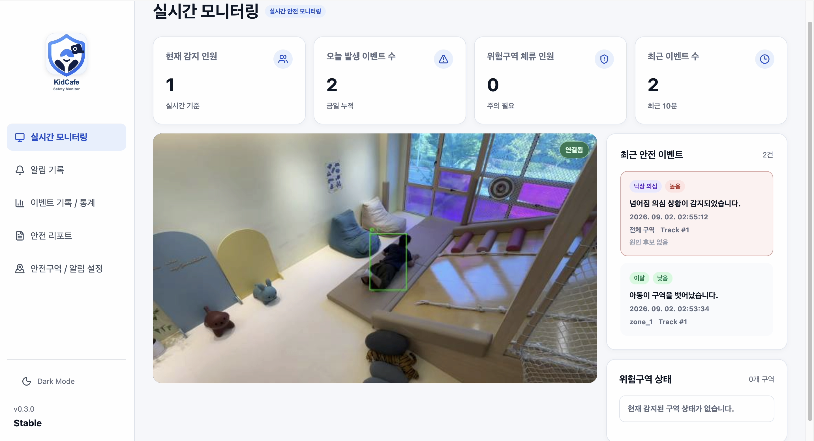
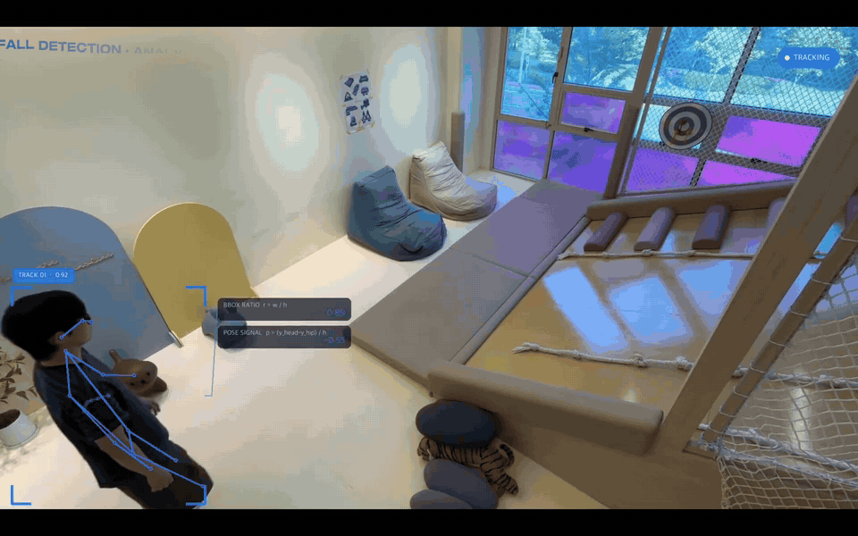
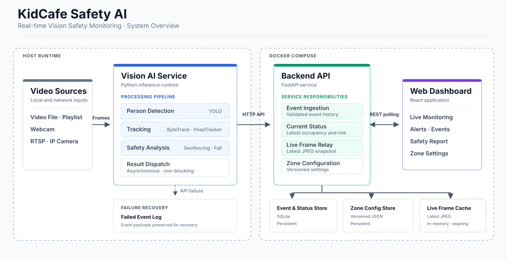

# KidCafe Safety AI

**카메라 영상으로 낙상과 위험구역 접근을 감지하는 키즈카페 안전 모니터링 시스템**

센서 착용 없이 사람의 움직임을 분석하고, 감지 이벤트·현재 인원·실시간 영상을 관리자 대시보드에 연결합니다.

[](https://github.com/kidcafe-safety-ai/kidcafe-safety-monitoring/actions/workflows/ci.yml)


**한이음 드림업 2026 · 3인 팀 · 2026.04–2026.10 · 개발 완료 (`v0.3.0`)**

[시연 영상](https://www.youtube.com/watch?v=kOI58emDueI) · [논문](https://ack.kips.or.kr/society/kips/conference/ack2026/file/downloadSoConfManuscript/abs/KIPS_C2026B0263F) · [실행 방법](#실행-방법) · [기술 문서](#기술-문서)

## 핵심 결과

| 항목 | 결과 | 평가 기준 |
| --- | --- | --- |
| 낙상 감지 | **15건 중 14건 감지 (93.3%)** | 학습 참여자와 분리한 최종 시험 |
| 평균 감지 지연 | **0.44초** | 동일 최종 시험 |
| 서비스 통합 | **API smoke test 7/7 통과** | 영상 2개·600프레임 처리, 이벤트 저장·대시보드 표시 확인 |

낙상 평가는 성인 재연·목표 카메라 1대 조건입니다. 서비스 통합 시험은 낙상 모델 평가와 별도로 수행했습니다. [낙상 평가](docs/fall_evaluation.md) · [통합 검증 기록](docs/final_validation.md)

**ACK 2026 논문 게재** — [비전 AI 기반 키즈카페 안전 모니터링 시스템의 설계 및 평가](https://ack.kips.or.kr/society/kips/conference/ack2026/file/downloadSoConfManuscript/abs/KIPS_C2026B0263F)

## 시연

[](https://www.youtube.com/watch?v=kOI58emDueI)

실시간 영상과 낙상·위험구역 이벤트를 확인하는 관리자 대시보드입니다. [시연 영상 보기](https://www.youtube.com/watch?v=kOI58emDueI)

<details>
<summary>낙상 감지·원인 후보 분석 GIF 보기</summary>



낙상 의심 상태 전이와 접촉 이력에 따른 원인 후보를 시각화한 예시입니다.

</details>

## 주요 기능과 기술

| 영역 | 구현 내용 | 주요 기술 |
| --- | --- | --- |
| 영상 분석 | 파일·웹캠·RTSP 입력, 사람 탐지·추적, 자세와 보조 모델을 결합한 낙상 판정 | Python, PyTorch, Ultralytics YOLO, OpenCV |
| 위험구역 감지 | 다각형 구역 설정, 진입·체류·이탈 및 제한구역 이벤트 생성 | Geofencing, Shapely, Track 상태 관리 |
| 서버·저장 | 이벤트·현재 상태·실시간 영상·구역 설정 API, 이벤트·상태 저장 | FastAPI, Pydantic, SQLite |
| 관리자 화면 | 실시간 모니터링, 알림·이벤트 기록, 통계·리포트, 구역 설정 | React, TypeScript, Vite |

## 시스템 구성과 설계



영상 분석은 호스트에서 실행합니다. FastAPI가 이벤트·현재 상태를 저장하고, React 대시보드는 REST polling으로 상태와 최신 JPEG 영상을 표시합니다. 서버와 대시보드는 Docker Compose로 실행합니다.

- **목표 환경에 맞춘 모델 보정:** 자세·보조 검출 신호의 미탐 원인을 분석하고, 현장 데이터를 기존 학습 데이터와 혼합했습니다. 참여자를 분리하고 설정을 고정한 뒤 최종 시험을 수행했습니다.
- **추론과 서버 전송 분리:** 이벤트를 로컬에 먼저 기록하고 비동기 큐로 전송합니다. 상태·영상은 대기값을 최신으로 교체해 전송 지연의 누적을 줄입니다.
- **영상 전환 시 상태 초기화:** 모델을 재사용하면서 추적·이벤트·낙상 판정 상태를 초기화해, 이전 영상의 상태가 다음 영상에 이어지지 않도록 했습니다.

## 팀과 역할

| 담당 | 구현 범위 |
| --- | --- |
| 정종민 | 개발 범위·일정·공통 인터페이스 조율, 탐지·추적·위험구역 이벤트, 낙상 판정·평가, 비동기 전송과 파트 간 통합 검증 |
| 원우민 | FastAPI·SQLite, CurrentStatus·Live Frame·Zone API, Docker와 운영 도구 |
| 정현수 | 실시간 모니터링, 이벤트·통계·리포트·구역 설정, API 상태별 UI와 Frontend 검증 |

## 실행 방법

**필요 환경:** Python 3.10, Docker + Compose. Frontend를 호스트에서 실행·검사하려면 Node.js 20이 필요합니다.

### 1. 설치

```bash
git clone https://github.com/kidcafe-safety-ai/kidcafe-safety-monitoring.git
cd kidcafe-safety-monitoring

python3.10 -m venv .venv
source .venv/bin/activate
python -m pip install -r requirements.txt
cp .env.example .env
```

Windows PowerShell에서는 가상환경 활성화에 `.\.venv\Scripts\Activate.ps1`을 사용합니다.

### 2. 서버·대시보드 실행

```bash
python scripts/init_zone_runtime.py
docker compose up --build -d
python scripts/api_smoke_test.py --base-url http://localhost:8000
```

[대시보드](http://localhost:3000) · [API 문서](http://localhost:8000/docs) · [Health check](http://localhost:8000/health)

### 3. 영상 분석 실행

직접 준비한 영상을 `data/videos/test.mp4`에 배치합니다.

```bash
python -m src.main \
  --source-type file \
  --source data/videos/test.mp4 \
  --zones outputs/zones_runtime.json \
  --api-url http://localhost:8000 \
  --live-frame-enabled \
  --fall-detection-disabled
```

기본 사람 탐지 모델은 최초 실행 시 자동 다운로드됩니다. 낙상 감지는 별도 학습 모델을 준비한 뒤 활성화합니다. [낙상 모델·웹캠·RTSP·다중 영상 실행 가이드](docs/vision_ai_final.md#실행-예시)

<details>
<summary>품질 검사 명령</summary>

CI는 Backend lint·pytest와 Frontend test·build를 실행합니다. 아래 명령으로 로컬에서도 확인할 수 있습니다.

```bash
flake8 src tests
pytest -q

cd frontend
npm ci
npm run test -- --run
npm run build
```

기존 최종 검증 결과와 환경은 [통합 검증 기록](docs/final_validation.md)에 정리했습니다.

</details>

## 기술 문서

| 문서 | 내용 |
| --- | --- |
| [Vision AI](docs/vision_ai_final.md) | 처리 흐름, 모델 설정, 입력·전송 정책과 실행 옵션 |
| [낙상 개발·평가](docs/fall_evaluation.md) | 기본 판정 개선, 현장 추가 학습과 참여자 분리 평가 |
| [Backend](docs/backend_final.md) | API·DB·Docker, 백업·복원과 운영 도구 |
| [Frontend](docs/frontend_final.md) | 화면별 데이터, polling, 오류·상태 처리 |
| [통합 검증](docs/final_validation.md) | 자동화 검사와 실제 영상·대시보드 연동 기록 |
| [API 계약](docs/api_contract.md) · [시스템 인터페이스](docs/interfaces.md) | 컴포넌트 간 요청·응답·데이터 규격 |
| [개발 로드맵](docs/roadmap.md) · [설계 결정](docs/decisions.md) | 단계별 개발 이력과 기술 선택 근거 |

## 공개 범위와 실행 조건

- 원본 촬영 영상·학습 데이터·모델 weight·DB·로그·실제 환경변수와 카메라 인증정보는 Git에서 제외합니다.
- 낙상 모델은 목표 카메라 환경에 맞춘 선택 기능이며, 실행 시 동결 profile의 SHA-256으로 모델을 확인합니다. 다중 영상 입력은 동일 해상도·FPS를 사용합니다.
- 연구·시연용 시스템입니다. 장시간 RTSP 운영, 자동 재연결, 인증·인가와 운영 배포 구성은 별도 적용 범위이며, Docker의 Vite 서버는 로컬 시연용으로 사용합니다.

## 라이선스

프로젝트 결과물의 공개 열람을 위한 저장소입니다. 별도의 오픈소스 라이선스를 부여하지 않았으며, 외부 사용은 팀과 사전 협의가 필요합니다.
